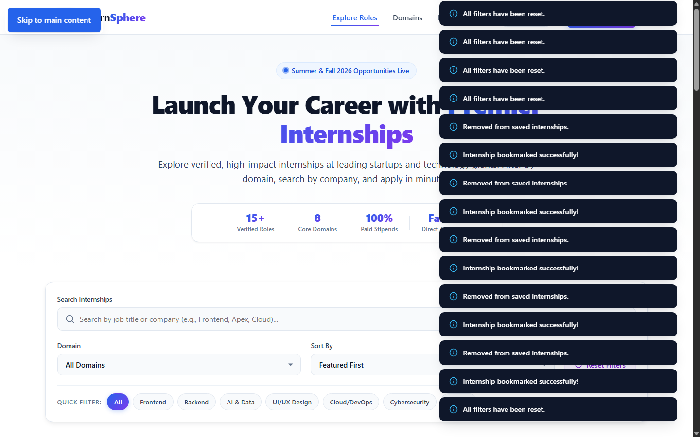
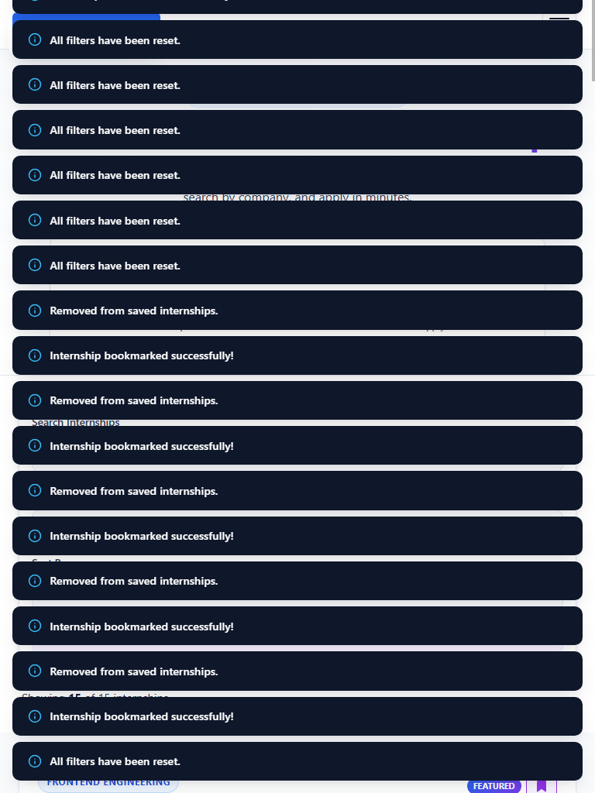
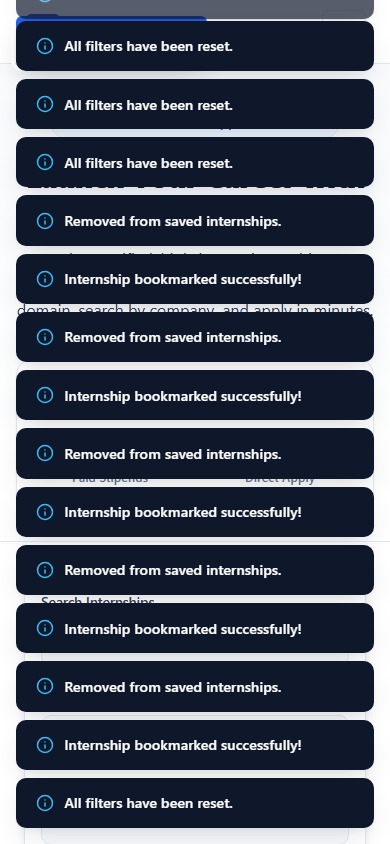

# InternSphere — Responsive Internship Board

> A lightweight, fully accessible, and zero-framework frontend web application for discovering and applying to premier internship opportunities. Built exclusively with **Semantic HTML5**, **Modern CSS3**, and **Vanilla JavaScript (ES6+)**.

---

## 📸 Interface Previews

| Desktop (1440 × 900) | Tablet (768 × 1024) | Mobile (390 × 844) |
| :---: | :---: | :---: |
|  |  |  |

---

## 🌟 Key Features

### 1. Curated Internship Opportunities
- **15 fictional opportunities** spanning 8 domains:
  - *Frontend Engineering*
  - *Backend Systems*
  - *Data Science & AI*
  - *UI/UX Design*
  - *Cloud & DevOps*
  - *Cybersecurity*
  - *Product Management*
  - *Mobile Development*
- Each card displays:
  - **Internship Title**
  - **Company Name & Avatar**
  - **Domain Tag (Color-Coded)**
  - **Location & Flexibility** (Remote, Hybrid, On-site)
  - **Duration** (e.g. 2 to 6 months)
  - **Stipend Badge**
  - **Description & Key Competency Tags**
  - **Apply Button & Interactive Bookmark Toggle**

### 2. Search, Filter & Sort Engine
- **Live Search**: Instant keyword filtering across internship title, company name, and technical skill tags with an instant clear button (`×`).
- **Domain Filter Dropdown & Quick Pills**: Synchronized dropdown menu and fast one-click domain pill buttons.
- **Combined Filtering**: Interlocking search keywords, category domains, and active filter tags.
- **Dynamic Active Filter Chips**: Removable chips reflecting active keyword and domain filters.
- **Sorting Options**:
  - *Featured First* (Highlights high-priority verified listings)
  - *Title (A to Z / Z to A)*
  - *Company (A to Z)*
  - *Duration (Shortest to Longest / Longest to Shortest)*
- **Reset Filters**: One-click action to reset search, domain, and sorting back to pristine default state.
- **Empty State**: Elegant empty-result screen with helpful query tips and a direct "Reset All Filters" button.

### 3. Application Workflow & Saved Roles
- **Accessible Application Dialog (`<dialog>`)**: Opens pre-populated role details, requires form validation (Name, Email, Portfolio, Notes), and displays a confirmed success state.
- **Saved Roles / Bookmarking Drawer**: Persists bookmarked roles in `localStorage`. Features a live navigation badge counter and dedicated drawer to review and manage saved opportunities.
- **Toast Notifications**: Non-intrusive interactive feedback messages for bookmarks, resets, and submissions.

---

## ♿ Accessibility & Standards (WCAG 2.1 AA)

- **Semantic HTML5 Elements**: Proper document outline using `<header role="banner">`, `<nav aria-label="...">`, `<main id="main-content" tabindex="-1">`, `<form role="search">`, `<article>`, `<dialog>`, and `<footer role="contentinfo">`.
- **Keyboard Navigation**:
  - Visible focus indicators with high-contrast blue/purple outlines (`:focus-visible`).
  - Dedicated **Skip to main content** link for screen reader and keyboard users.
  - Dialog focus trapping and automatic focus restoration to the triggering element upon dialog close.
  - `Escape` key closes active dialogs and the mobile navigation drawer.
- **Accessible Form Controls**: Every input, select, and textarea has a dedicated `<label for="...">`.
- **ARIA Live Regions**: Live announcements via `aria-live="polite"` on dynamic search results count, empty states, and toast notifications.
- **Color Contrast**: All text and domain badges exceed WCAG 2.1 AA contrast requirements (standard text >= 4.5:1, large text/badges >= 3:1).

---

## 📱 Responsive Layout & Breakpoints

Designed fluidly from mobile to ultra-wide displays with **zero horizontal overflow** (`overflow-x: hidden`, box-sizing boundary protection):

| Viewport | Screen Width | Grid Layout | Navigation |
| :--- | :---: | :---: | :--- |
| **Desktop** | > 1024px | 3 Columns | Horizontal navigation bar with CTA |
| **Laptop** | 1024px – 1366px | 3 Columns | Full fluid desktop layout |
| **Tablet** | 768px – 1023px | 2 Columns | Fluid 2-column grid, responsive header |
| **Mobile** | < 768px | 1 Column | Collapsible hamburger drawer, stacked filters |
| **Small Mobile** | 360px – 420px | 1 Column | Compact margins, wrapped card actions |

---

## 📁 Project Structure

```text
responsive-internship-board/
│
├── index.html              # Main semantic HTML5 webpage
├── README.md               # Project documentation & deployment guide
├── TEST_REPORT.md          # Comprehensive QA test report (39 passed tests)
│
├── css/
│   └── style.css           # Vanilla CSS3 styles, theme variables, media queries
│
├── js/
│   └── app.js              # Vanilla ES6+ application logic & state management
│
├── data/
│   └── internships.json    # JSON dataset containing 15 fictional internship listings
│
└── screenshots/
    ├── desktop.png         # Desktop viewport screenshot (1440 × 900)
    ├── tablet.png          # Tablet viewport screenshot (768 × 1024)
    └── mobile.png          # Mobile viewport screenshot (390 × 844)
```

---

## 🧪 Comprehensive QA Testing & Results

An automated end-to-end test suite (`run-automated-tests.js`) was executed against the running application in headless Google Chrome via the Chrome DevTools Protocol (CDP).

### Test Summary:
- **Total Tests Executed**: 39
- **Passed**: 39
- **Failed**: 0
- **Pass Rate**: 100%

### Test Categories Verified:
1. **Functional Testing (18 Tests)**:
   - Live title search, company search, and skill tags search.
   - Domain dropdown, quick pill buttons, and combined search + domain filtering.
   - Featured sorting, alphabetical sorting (A–Z / Z–A), company sorting, and duration sorting.
   - Clear filters, dynamic active filter chips, and empty results state.
   - Modal opening/closing, focus restoration, form submission, bookmarking, and localStorage persistence.
2. **Edge Case Testing (11 Tests)**:
   - Whitespace trimming, invalid search terms, reset actions, and multiple simultaneous filters.
   - Missing/malformed JSON handling, empty dataset safety, and long string line-wrapping.
   - Special characters & XSS tag sanitization, rapid stress clicking, and `file:///` offline fallback resilience.
3. **Responsive Testing (5 Viewports)**:
   - Desktop (1440×900), Laptop (1366×768), Tablet (768×1024), Mobile (390×844), Small Mobile (360×800).
   - Zero horizontal overflow confirmed on all viewports.
4. **Accessibility Testing (4 Test Suites)**:
   - Semantic HTML structure and landmark presence.
   - Form label bindings (`<label for="...">`).
   - Screen-reader dynamic announcements (`aria-live="polite"`).
   - Skip link and keyboard focus visibility.

*(See [`TEST_REPORT.md`](TEST_REPORT.md) for full individual test logs and execution outputs.)*

### How to Run the Automated Test Suite:
```bash
# Run the automated test runner (requires Node.js 22+ and Google Chrome)
node run-automated-tests.js
```

---

## 🚀 GitHub Repository Preparation & Local Setup

### 1. Local Preview
You can open `index.html` directly in any web browser:
- Double-click `index.html` (the built-in offline fallback ensures full functionality via `file://`).
- Alternatively, launch with any local static HTTP server:
  ```bash
  # Using Python 3:
  python -m http.server 8000

  # Using Node.js npx:
  npx serve .
  ```
- Navigate to `http://localhost:8000/`.

### 2. Git Repository Initialization
To publish this project to GitHub:
```bash
# Navigate to the project folder
cd responsive-internship-board

# Initialize git
git init

# Add all project files
git add .

# Commit project files
git commit -m "feat: complete responsive internship board with accessible UI and test suite"

# Rename default branch to main
git branch -M main

# Link your remote repository (replace with your actual GitHub URL)
git remote add origin https://github.com/<YOUR-USERNAME>/<YOUR-REPOSITORY-NAME>.git

# Push to GitHub
git push -u origin main
```

---

## 🌐 GitHub Pages Deployment Instructions

Deploying your internship board to GitHub Pages takes under two minutes:

1. **Log in to GitHub** and open your repository.
2. Click on the **Settings** tab (gear icon at the top right of the repository).
3. In the left navigation menu, scroll down to the **Code and automation** section and select **Pages**.
4. Under **Build and deployment**:
   - **Source**: Select `Deploy from a branch`.
   - **Branch**: Choose `main` from the dropdown list.
   - **Folder**: Select `/ (root)`.
5. Click **Save**.
6. GitHub Actions will automatically build and publish your site. After 1–2 minutes, refresh the page.
7. Your live website URL will be displayed at the top of the Pages settings:
   ```text
   https://<YOUR-USERNAME>.github.io/<YOUR-REPOSITORY-NAME>/
   ```
8. Visit your deployed link to test the live, responsive board on any device!
